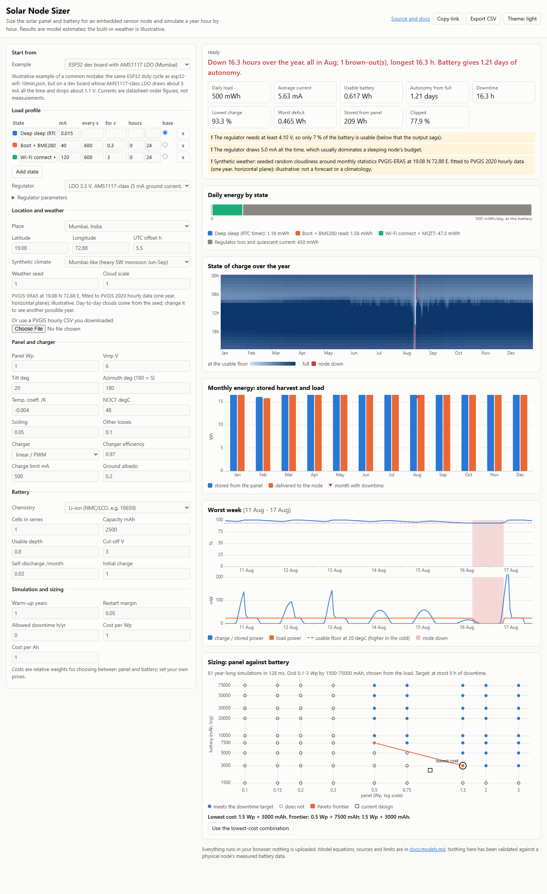
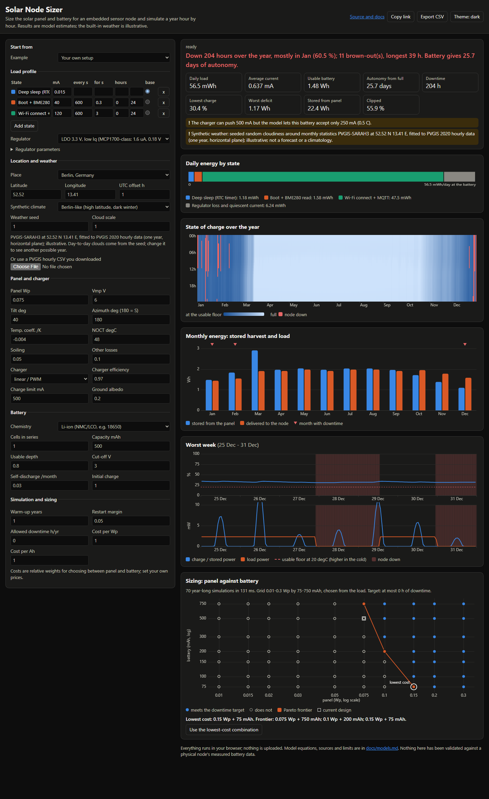

# Solar Node Sizer

[](https://github.com/projectbin07-stack/solar-node-sizer/actions/workflows/ci.yml)
[](LICENSE)

Size the solar panel and battery for an always-on or duty-cycled embedded
node (ESP32, ATmega, nRF, LoRa...) and simulate a whole year hour by hour to
see whether it survives the worst weeks.

**Live demo: https://projectbin07-stack.github.io/solar-node-sizer/**

> **Results are model estimates.** The built-in weather is synthetic and
> illustrative (fitted to a single year of data per place), the example
> currents are datasheet-order figures, and **nothing here has been validated
> against a physical node's measured battery data.** Use it to compare
> designs and find the order of magnitude, then measure your node and leave
> margin.



The same ESP32 node with a low-Iq LDO, 0.075 Wp and 500 mAh in a
Berlin-like climate (dark theme,
[link](https://projectbin07-stack.github.io/solar-node-sizer/?cl=berlin&lat=52.52&lon=13.41&tz=1&tilt=40&wp=0.075&mah=500&theme=dark)):
the heatmap shows the battery draining from November to February, the
outages in red, and the worst week in late December.



## Why

"Will a 1 W panel and an 18650 keep my ESP32 alive through the monsoon?"
is usually answered with a back-of-the-envelope "sun-hours x panel watts"
line and a guess for the battery. The things that actually decide it are
easy to miss on paper: the regulator's quiescent current and dropout, a
linear charger throwing away a third of the panel, the cut-off voltage that
leaves part of the battery unusable, self-discharge, and above all runs of
dark days. This tool puts all of them in one hourly simulation, for a
synthetic year or for real PVGIS data for your site, and searches panel and
battery sizes for the cheapest combination that never browns out.

## Features

- **Load profile**: any number of states (deep sleep, sensor read, radio
  TX...) with current, period, duration and optional time-of-day window;
  daily energy budget per state in mAh and mWh.
- **Regulators**: none, LDO (quiescent current and dropout, so a
  battery voltage floor) and switching converters with a per-state
  efficiency curve. Presets for an MCP1700-class LDO, an AMS1117-class
  dev-board LDO, a buck and a buck-boost.
- **Solar resource**: NOAA solar position, Haurwitz clear sky, Erbs
  beam/diffuse split, isotropic transposition to the panel tilt and
  azimuth; seeded day-to-day cloudiness with presets for Bengaluru, Mumbai,
  New Delhi, Chennai, Guwahati, Nairobi and Berlin; or **your own PVGIS
  hourly or TMY CSV**.
- **Panel and charger**: Wp, tilt, azimuth, temperature coefficient (NOCT
  model), soiling and other losses; MPPT or linear/PWM charger with
  efficiency and current limit.
- **Battery**: Li-ion, LiFePO4, NiMH and low self-discharge NiMH presets;
  cells in series, capacity, usable depth, cut-off voltage, self-discharge,
  charge efficiency, C-rate with a taper near full, no charging below 0 degC
  or above 45 degC, cold derating, peak-current check.
- **Hourly year simulation** with warm-up, brown-out and restart: energy
  harvested, stored, clipped and delivered, hours of downtime, lowest
  charge, days of autonomy (how long a full battery lasts with no sun, load
  plus self-discharge) and the worst consecutive-days deficit.
- **Sizer**: simulates a grid of panel and battery sizes (chosen from the
  load), plots the Pareto frontier and picks the lowest-cost combination
  that meets a downtime target.
- **App**: load-profile table, stacked bar of daily energy per state, year
  heatmap of state of charge (day x hour), monthly harvest vs load bars,
  worst-week zoom, sizing chart, one-line verdict, warnings about the parts
  combination, shareable URLs, configuration JSON import (file picker or
  drag and drop, including the export of
  [embedded-power-profiler](https://github.com/projectbin07-stack/embedded-power-profiler)),
  CSV export, light/dark, phone layout. No
  external assets, no network calls, no build step.
- **CLI**: `simulate` and `size` on JSON configurations, text or JSON
  output, CSV export, deterministic for a seed.

## Quick start

In the browser: open the [live demo](https://projectbin07-stack.github.io/solar-node-sizer/).
It starts with an ESP32 + BME280 node reporting over Wi-Fi every 10 minutes
in a Bengaluru-like climate. Try:

1. Pick the **ESP32 dev board with AMS1117 LDO** example: the regulator's
   5 mA ground current makes the regulator the biggest load, and its 1.1 V
   dropout leaves only 7 % of the Li-ion cell usable.
2. Set the panel to 0.02 Wp and look at the heatmap and the worst week.
3. Change the weather seed to see another possible year from the same
   climate statistics, or load a PVGIS file (below).

Locally (Node 22 or newer):

```bash
git clone https://github.com/projectbin07-stack/solar-node-sizer.git
cd solar-node-sizer
npm ci                 # dev tools only
npm run serve          # then open http://127.0.0.1:8000/
```

Any static file server works; ES modules do not load from `file://`.

URL parameters hold every setting that differs from the default (for
example `?wp=0.5&mah=1000&cl=mumbai&lat=19.08&lon=72.88`), the load as
`L=name~mA~every~duration[~from~to];...` with `b` for the base state, and
`theme=light|dark`. **Copy link** copies the current setup. A loaded PVGIS
file is not part of the link.

**Importing a configuration.** "Or import a configuration JSON" under
_Start from_ (or dropping a `.json` file anywhere on the page) reads the
same JSON the CLI reads. Every section in the file replaces the current
one; sections it leaves out keep their current values, so a measured load
profile exported by embedded-power-profiler (`epp export LOG --solar-node-sizer
load.json`, which holds only `name`, `note` and `load`) replaces the load
table and keeps your location, panel, battery and regulator. A full
configuration (`--full-config`) replaces everything. A file that is not
valid JSON or not a valid configuration is reported and nothing changes.
Dropping a `.csv` file loads it as PVGIS data.

## Using PVGIS data for your location

PVGIS is a free tool of the European Commission's Joint Research Centre and
covers India, the rest of Asia, Africa, Europe and the Americas.

1. Open https://re.jrc.ec.europa.eu/pvg_tools/en/ and click your site on the
   map (or type the coordinates).
2. Choose the **Hourly data** tab. Pick a radiation database and a single
   year (start = end year; try a few different years, a bad monsoon year
   matters more than an average one).
3. Under "Mounting type" choose **Fixed**, enter your panel's **slope**
   (tilt) and **azimuth** (PVGIS: 0 = south, 90 = west, -90 = east). PV
   power and components are optional; this tool only uses the irradiance
   and the air temperature.
4. Download **CSV**. Load it with "Or use a PVGIS hourly CSV you
   downloaded" in the app, or pass `--pvgis file.csv` to the CLI. The tilt
   and azimuth then come from the file.

The **TMY** tab works too (typical meteorological year; the tool transposes
it to the panel tilt you set). The file is read locally and never uploaded.
PVGIS times are UTC; they are shifted to local time using the UTC offset you
set (rounded to the hour).

## CLI

```
$ node bin/solar-node-sizer.js --help
solar-node-sizer 0.1.2: solar panel and battery sizing for embedded nodes

Usage:
  solar-node-sizer simulate <config.json> [options]
  solar-node-sizer size <config.json> [options]
  solar-node-sizer presets [--json]
  solar-node-sizer --help | --version

simulate runs the hour-by-hour year for the panel and battery in the
configuration and prints the energy budget, the energy flows and whether
the node stays up. size simulates every combination of the sizer's panel
and battery grids and prints the downtime table, the Pareto frontier and
the lowest-cost combination that meets the downtime target.

Options:
  --pvgis <file.csv>   use a PVGIS hourly-data or TMY CSV you downloaded
                       instead of the synthetic weather
  --seed <n>           synthetic weather seed (overrides location.seed)
  --wp <W>             panel size (overrides panel.wp)
  --mah <mAh>          battery capacity (overrides battery.capacityMah)
  --json               print JSON instead of text
  --csv <file>         (simulate) write the hourly results to a CSV file

Results are model estimates. The synthetic weather is illustrative; see
docs/models.md for the equations and their limits.
```

Example configurations are in [`examples/`](examples) (all illustrative).
The AMS1117 dev-board example, simulated:

```
$ node bin/solar-node-sizer.js simulate examples/esp32-devboard-ams1117.json
config       ESP32 dev board (AMS1117 LDO), Wi-Fi report every 10 min, Mumbai (illustrative)
weather      Synthetic year: Mumbai-like (heavy SW monsoon Jun-Sep), seed 1
panel        1 Wp, tilt 20 deg, azimuth 180 deg, linear charger, limit 500 mA
battery      Li-ion (NMC/LCO, e.g. 18650), 1S 2500 mAh = 9.25 Wh, usable 0.617 Wh (floor 93.3 %, set by regulator)
regulator    LDO 3.3 V, AMS1117-class (5 mA ground current, 1.1 V dropout)
daily budget (at the battery, nominal voltage)
  Deep sleep (RTC timer)     23.9 h    0.358 mAh     1.18 mWh
  Boot + BME280 read        0.012 h     0.48 mAh     1.58 mWh
  Wi-Fi connect + MQTT       0.12 h     14.4 mAh     47.5 mWh
  regulator overhead                                  450 mWh
  total                    500 mWh/day = 135 mAh/day, average 5.63 mA
year (365 days)
  panel output           1475 Wh
  charger output         996 Wh
  stored in battery      209 Wh (charge loss 11 Wh)
  clipped                776 Wh (battery full or charge limits)
  delivered to node      205 Wh (unserved 0.376 Wh)
  self-discharge         3.34 Wh
  stored energy          9.11 -> 9.11 Wh
  downtime               16.3 h in 1 outage(s), longest 16.3 h
  lowest charge          93.3 % on 16 Aug
  worst deficit          0.465 Wh over 3 day(s) from 14 Aug
  autonomy               1.21 days from full
month   stored Wh   load Wh   down h
  Jan        17.8      17.5        0
  Feb          16      15.8        0
  Mar        17.8      17.5        0
  Apr        17.2      16.9        0
  May        17.8      17.5        0
  Jun        17.2      16.9        0
  Jul        17.8      17.5        0
  Aug        17.3      17.1     16.3
  Sep        17.2      16.9        0
  Oct        17.7      17.5        0
  Nov        17.2      16.9        0
  Dec        17.7      17.5        0
note: The regulator needs at least 4.10 V, so only 7 % of the battery is usable (below that the output sags).
note: The regulator draws 5.0 mA all the time, which usually dominates a sleeping node's budget.
note: Synthetic weather: seeded random cloudiness around monthly statistics PVGIS-ERA5 at 19.08 N 72.88 E, fitted to PVGIS 2020 hourly data (one year, horizontal plane); illustrative; not a forecast or a climatology.
result: Down 16.3 hours over the year, all in Aug; 1 brown-out(s), longest 16.3 h. Battery gives 1.21 days of autonomy.
```

Sizing the ESP32 example (grid chosen from the load; `ok` = no downtime,
`peak` = too small for the 120 mA Wi-Fi burst at 2 C):

```
$ node bin/solar-node-sizer.js size examples/esp32-wifi-10min.json
config       ESP32 + BME280, Wi-Fi report every 10 min, Bengaluru (illustrative)
weather      Synthetic year: Bengaluru-like (SW monsoon Jun-Sep, NE monsoon Oct-Dec), seed 1
target       downtime <= 0 h per year (70 simulations)
downtime hours (rows: panel Wp, columns: battery mAh)
  Wp \ mAh     75    100    150    200    300    500    750
      0.01   5128   5131   5137   5144   5156   5182   5216
     0.015   3309   3311   3317   3322   3335   3360   3394
      0.02   1501   1498   1502   1507   1519   1544   1577
      0.03   19.9     ok     ok     ok     ok     ok     ok
      0.05     ok     ok     ok     ok     ok     ok     ok
     0.075     ok     ok     ok     ok     ok     ok     ok
       0.1     ok     ok     ok     ok     ok     ok     ok
      0.15     ok     ok     ok     ok     ok     ok     ok
       0.2     ok     ok     ok     ok     ok     ok     ok
       0.3     ok     ok     ok     ok     ok     ok     ok
  ok = no downtime; peak = below 60 mAh the battery cannot deliver the peak current
frontier (smallest battery for each panel size that meets the target)
   0.03 Wp +    100 mAh   lowest charge 28.6 %
   0.05 Wp +     75 mAh   lowest charge 79.7 %
best         0.05 Wp + 75 mAh (relative cost 0.125 with 1/Wp and 1/Ah)
```

With a PVGIS file downloaded as described above (Bengaluru, PVGIS-ERA5,
2020, slope 15 deg, azimuth 0) and a 0.05 Wp panel with a 100 mAh cell:

```
$ node bin/solar-node-sizer.js simulate examples/esp32-wifi-10min.json --wp 0.05 --mah 100 --pvgis Timeseries_12.972_77.594_E5_15deg_0deg_2020_2020.csv
config       ESP32 + BME280, Wi-Fi report every 10 min, Bengaluru (illustrative)
weather      PVGIS hourly data at 12.972, 77.594 (PVGIS-ERA5, 2020-2020)
panel        0.05 Wp, tilt 15 deg, azimuth 180 deg, linear charger, limit 500 mA
battery      Li-ion (NMC/LCO, e.g. 18650), 1S 100 mAh = 0.37 Wh, usable 0.296 Wh (floor 20 %, set by dod)
regulator    LDO 3.3 V, low Iq (MCP1700-class: 1.6 uA, 0.18 V dropout)
daily budget (at the battery, nominal voltage)
  Deep sleep (RTC timer)     23.9 h    0.358 mAh     1.18 mWh
  Boot + BME280 read        0.012 h     0.48 mAh     1.58 mWh
  Wi-Fi connect + MQTT       0.12 h     14.4 mAh     47.5 mWh
  regulator overhead                                 6.24 mWh
  total                    56.5 mWh/day = 15.3 mAh/day, average 0.637 mA
year (366 days)
  panel output           75.6 Wh
  charger output         50.7 Wh
  stored in battery      23.2 Wh (charge loss 1.22 Wh)
  clipped                26.3 Wh (battery full or charge limits)
  delivered to node      23.1 Wh (unserved 0 Wh)
  self-discharge         0.13 Wh
  stored energy          0.344 -> 0.344 Wh
  downtime               0 h in 0 outage(s), longest 0 h
  lowest charge          74.4 % on 5 Dec
  worst deficit          0.0478 Wh over 2 day(s) from 3 Dec
  autonomy               5.22 days from full
month   stored Wh   load Wh   down h
  Jan        1.98      1.96        0
  Feb        1.84      1.83        0
  Mar        1.97      1.96        0
  Apr        1.91       1.9        0
  May        1.97      1.96        0
  Jun        1.91       1.9        0
  Jul        1.97      1.96        0
  Aug        1.97      1.95        0
  Sep         1.9      1.89        0
  Oct        1.97      1.96        0
  Nov         1.9      1.89        0
  Dec        1.95      1.95        0
note: The charger can push 500 mA but the model lets this battery accept only 50 mA (0.5 C).
note: Time zone 5.5 h rounded to 6 h to align the hourly rows with local hours.
result: Survives the year with 5.22 days of autonomy from a full battery; lowest state of charge 74.4 % around 5 Dec.
```

`--json` prints the same results as JSON (budget, totals, monthly figures,
downtime, warnings); `size --json` adds the full downtime grid.

A configuration is JSON; every field is optional and defaults to the ESP32
example. See [`examples/esp32-wifi-10min.json`](examples/esp32-wifi-10min.json)
for the full set; `node bin/solar-node-sizer.js presets` lists the climates,
cities, chemistries and regulators.

## Models

Full equations, sources and limits: [docs/models.md](docs/models.md). In
short:

| Part              | Model                                                                                                                                                                          | Main limits                                                           |
| ----------------- | ------------------------------------------------------------------------------------------------------------------------------------------------------------------------------ | --------------------------------------------------------------------- |
| Sun position      | NOAA calculator equations (Meeus), checked against Meeus examples and the NREL SPA example to < 0.01 deg                                                                       | none that matter at hourly resolution                                 |
| Clear sky         | Haurwitz: `GHI = 1098 cos z exp(-0.059 / cos z)`                                                                                                                               | no turbidity or altitude; the cloud factors are fitted relative to it |
| Diffuse split     | Erbs: diffuse fraction from `kt = GHI / (I0 cos z)`                                                                                                                            | a correlation, scattered for individual hours                         |
| Tilted panel      | isotropic sky + ground albedo + ASHRAE IAM (b0 = 0.05)                                                                                                                         | no circumsolar/horizon brightening, no shading                        |
| Synthetic weather | daily index `k = clamp(mean_m + std_m z_d, 0.03, 1.1)`, AR(1) `z_d`, fitted to PVGIS 2020                                                                                      | one year per place, one factor per day, illustrative                  |
| Panel             | `P = Wp G/1000 (1 + gamma (Tc - 25)) (1 - soiling)(1 - losses)`, `Tc = Ta + G (NOCT - 20)/800`                                                                                 | no low-light, spectral or mismatch model beyond the loss factor       |
| Charger           | MPPT: `P eta`; linear/PWM: `(P / Vmp) eta Vbat`; both capped at the current limit                                                                                              | panel voltage assumed high enough                                     |
| Load              | duty-cycle average per hour; LDO `Vb (I + Iq)`, switching `I Vout / eta(I) + Vb Iq`                                                                                            | hourly averages, no inrush or sag                                     |
| Battery           | energy bucket, usable window from DoD / cut-off / regulator minimum, charge efficiency, C-rate taper solved within the hour, 0-45 degC charging, cold derating, self-discharge | coarse OCV tables, no internal resistance, no ageing                  |

On the one site where it can be compared, the synthetic Bengaluru year gives
1943 kWh/m^2 on a 15 deg south-facing plane (seed 1; 1873-1958 for seeds
1-3) against 1954 kWh/m^2 from PVGIS-ERA5 for 2020, the year the preset was
fitted to. That checks the fitting and the geometry, not the battery model.

## Architecture

```
index.html, styles.css        static page, no build step
src/core/  (DOM-free, tested under Node)
  solar.js      sun position, clear sky, Erbs split, transposition
  weather.js    climate presets, seeded daily cloudiness, air temperature
  pvgis.js      PVGIS hourly-data and TMY CSV parser
  resource.js   hourly plane-of-array irradiance + temperature in local time
  load.js       load states, schedules, regulators, daily budget
  pv.js         panel output and charger models
  battery.js    chemistries, OCV tables, derating, self-discharge
  config.js     configuration defaults, validation, battery limits, warnings
  simulate.js   hourly simulation, charge integration, deficit
  sizer.js      grid search, automatic grids, Pareto frontier
  model.js      glue: resource -> simulation -> summary, JSON, CSV
  examples.js   the example configurations (same as examples/*.json)
src/ui/
  state.js      URL <-> configuration, JSON import (tested)
  draw.js       canvas charts with hover tooltips
  app.js        form wiring
src/cli.js, bin/solar-node-sizer.js   command-line interface
scripts/fit-climate.js                fits a climate preset to a PVGIS file you downloaded
scripts/browser-import-test.js        headless-browser test of the JSON import (CI)
```

The browser and the CLI run exactly the same `src/core` code.

## Tests

```bash
npm run check        # Prettier, tsc --checkJs --strict, node:test with coverage thresholds
```

On the development machine (Windows 11, Node 25) `npm run coverage` reports
93 tests, 93 passing, with 99.8 % line, 95.1 % branch and 98.2 % function
coverage over the measured files (the canvas and DOM code in
`src/ui/app.js` and `src/ui/draw.js` is excluded; it is exercised by the
browser smoke test in CI).

What the tests check against:

- **Solar position**: Meeus examples 25.a and 28.b (declination, apparent
  longitude, equation of time) and the NREL SPA worked example (zenith and
  azimuth within 0.05 deg).
- **Clear sky**: zero at night, 1035 W/m^2 overhead, peak in the solar-noon
  hour, plausible annual and noon magnitudes.
- **Energy balance**: `stored - delivered - self-discharge = change in
stored energy` to 1e-9 Wh, monthly sums equal the totals, clipping and
  charge-efficiency identities.
- **Bounds and behaviour**: state of charge within [0, 1] and above the
  floor whenever the node runs; a node without a panel runs for about its
  autonomy; no charging below 0 degC.
- **Autonomy**: hand-stepped values with and without self-discharge, a
  brute-force hourly loop, the continuous solution, the old
  `usable / daily load` result when self-discharge is zero, and an exact
  match with a no-sun simulation run when the load does not depend on the
  battery voltage.
- **Regulators**: hand-computed LDO and buck battery power; the buck beats
  the LDO on the radio burst and loses on a pure sleep load.
- **PVGIS parsing** on hand-written files in the documented layout
  (`tests/fixtures/`, numbers typed for the tests, not PVGIS output):
  metadata, azimuth conversion, components, TMY re-timing, CRLF and BOM,
  bad values, gaps.
- **Sizer**: more panel never increases downtime (three climates); more
  battery never increases downtime with self-discharge and restart margin
  set to zero (with them it can, see docs/models.md); frontier
  non-dominated; lowest cost.
- **Determinism**: same seed, same year and same CLI output.
- **Load windows**: a once-a-day event in a one-hour `from`/`to` window
  is one event a day (1.6667 mAh at 100 mA for 60 s), the same as without
  the window.
- **Configuration import**: a real embedded-power-profiler export (load
  only, and full configuration) gives the same configuration as the CLI;
  bad files are rejected with a message.
- **CLI output shape**, URL round trips, configuration errors.

CI runs the checks on Ubuntu and Windows with Node 22 and 24, smoke-tests
the CLI, and loads the page in headless Chrome to check that the simulation
and the sizer ran. A second headless-Chrome step
(`scripts/browser-import-test.js`, DevTools protocol, no dependencies)
imports an embedded-power-profiler export through the file input and by a
synthetic drop event and checks the page's results against the CLI's
(512 mWh/day, 14.3 days autonomy).

## Known limitations

- **Not validated against hardware.** No measured battery voltage, current
  or state of charge from a real node has been compared with the
  simulation.
- Synthetic weather is illustrative: one fitted year per place, one cloud
  factor per day (no intra-day variability), no inter-annual variation
  beyond the random seed. Use PVGIS data, ideally several years, for real
  decisions.
- Hourly resolution: duty cycles are averaged within the hour; peak
  currents are only checked against a C-rate limit; no voltage sag,
  internal resistance, brown-out detector timing or inrush.
- Battery model: coarse OCV tables, temperature-independent self-discharge,
  no ageing or capacity fade, battery temperature = air temperature.
- Panel model: isotropic sky, no shading, a single loss factor for
  low-light behaviour and real-vs-label output of cheap panels.
- Half-hour time zones are rounded to the hour when aligning PVGIS data.

## Roadmap

- Several PVGIS years at once, reporting the worst year.
- Battery internal resistance and voltage sag for high-current bursts.
- Enclosure temperature model.
- Import of measured node logs (voltage over time) to compare with the
  simulation.

## License

MIT, see [LICENSE](LICENSE). PVGIS data is (c) European Union; none is
included in this repository.
